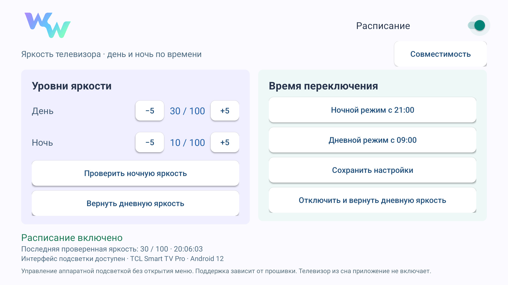

# WWave

Real TV panel brightness on a daily schedule. Remote-friendly settings and a pastel WW monogram.

**Рабочая версия 1.9: локальный установщик `build/WWave-1.9.apk`.** Изменения проверены на одном TCL; широкий список моделей пока не подтверждён испытаниями.



## Что делает приложение

WWave меняет настоящую подсветку через штатную библиотеку TCL **без открытия меню и переключения текущего приложения**. Ночной режим по умолчанию: **21:00–09:00**, ночью **10/100**, днём **30/100**. Время и уровни редактируются на экране настроек.

Есть переключатель расписания, проверка ночного уровня, возврат дневного и кнопка **«Отключить и вернуть дневную яркость»**. Отключение отменяет таймеры и останавливает службу после возврата дневного уровня.

## Совместимость и установка

Проверено на **TCL G10 / C6KS, Android 12**. Минимальная версия установки — Android 8; другие прошивки не проверены. Для TCL нужен PQ SDK или TVManager. Для Sony BRAVIA и коммерческих Hisense DS добавлены экспериментальные REST-адаптеры по официальной документации; реальное железо этих марок пока не проверено. WWave определяет его автоматически и отдельно проверяет чтение и реальное изменение. Другие TCL/iFFALCON — кандидаты на поддержку, до испытаний на их прошивках. [Матрица совместимости](docs/COMPATIBILITY.md). При отсутствии библиотеки или отказе доступа WWave показывает ошибку; меню автоматически не открывается.

1. Установите `WWave-1.9.apk` на телевизор, поверх прежней версии для сохранения настроек.
2. Откройте WWave и нажмите **«Совместимость»**. Проверка прочитает текущую подсветку, без изменения уровня.
3. Выберите дневную/ночную яркость и время, сохраните настройки, проверьте оба режима и включите расписание.

**Для штатного TCL-адаптера ADB, компьютер и сеть не нужны.** Sony/Hisense используют HTTP только к серверу самого телевизора (127.0.0.1); доступ через localhost требует проверки на каждой прошивке. APK запрашивает INTERNET для этих адаптеров, не содержит ADB-клиента и не сканирует сеть. Выбор: «Совместимость» → «Выбрать интерфейс», при выключенном расписании. Ключ PSK хранится зашифрованным.

Изменяется текущий профиль изображения (`EN_APPLY_CURRENT`). Переключение источника, отдельные HDMI/HDR-профили, полная перезагрузка и другие прошивки не проверены. Выключенный телевизор приложение не включает.

Если FLauncher не добавил плитку: **Settings → Applications → TV Applications → WWave → «+» → TV Applications**.

## Сборка на Windows

Нужны JDK 17, Android SDK Platform 32 и Build Tools 34.0.0. Ресурсы включены в репозиторий; библиотека TCL берётся с самого телевизора, её бинарник не распространяется в APK.

```powershell
$env:JAVA_HOME = 'C:\path\to\jdk-17'
$env:ANDROID_SDK_ROOT = 'C:\path\to\Android\Sdk'
.\build.ps1 -Unsigned
```

Для подписанного APK задайте `WW_KEYSTORE` и `WW_KEYSTORE_PASSWORD` в окружении. Закрытый ключ не публикуется; APK с другой подписью не обновит официальную установку.

Для упаковки размеров иконки: `python scripts/prepare_assets.py` (Pillow).

## Устройство

- `MainActivity` — настройки и проверка доступа.
- `NativeBacklight` — два известных TCL-контракта, выбор по доступности API, обязательное чтение результата и попытка восстановления при отказе записи.
- `RestBacklight`, `LocalTvHttp`, `BacklightScale` — экспериментальные Sony/Hisense, ограниченный локальный HTTP и преобразование родной шкалы.
- `TvApiKey` — ключ IP control в Android Keystore.
- `TclBrightness` — связь контроллера с настройками приложения и подтверждение записи для конкретной прошивки.
- `ScheduleWindow` — расчёт дневного/ночного интервала через полночь.
- `ScheduleService`, `AlarmReceiver`, `BootReceiver` — расписание и применение уровня.
- `ControlReceiver` — диагностика, защищённая системным разрешением `android.permission.DUMP`.

Проверка логики совместимости и ошибок: `tests/run.ps1 -JdkRoot C:\path\to\jdk-17`. Синтетические тесты не подтверждают поддержку реального телевизора.

Root, сервер, аккаунт и облачная синхронизация не требуются.

[Результат ревью других марок и известные ограничения](docs/REVIEW.md).

[Проверки версии 1.9](docs/VERIFICATION-1.9.md).
